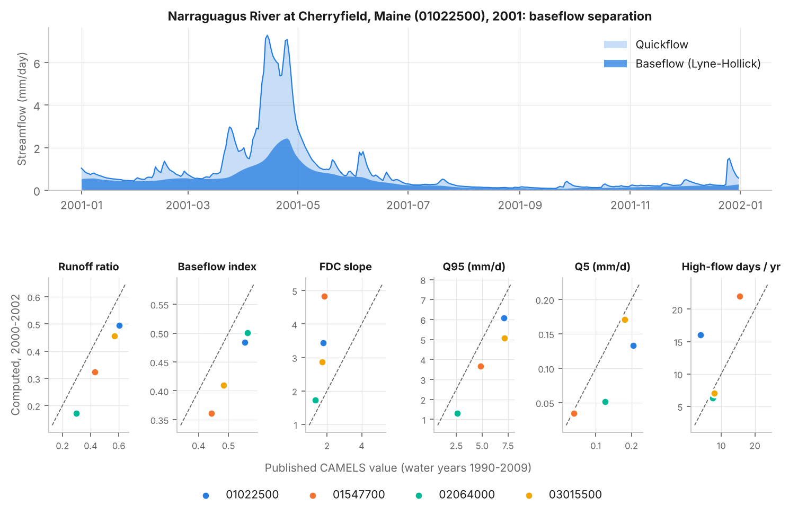
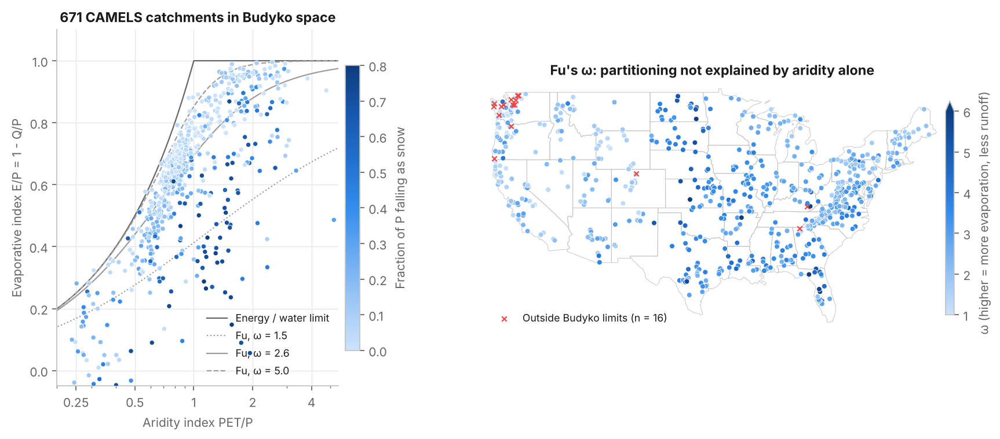
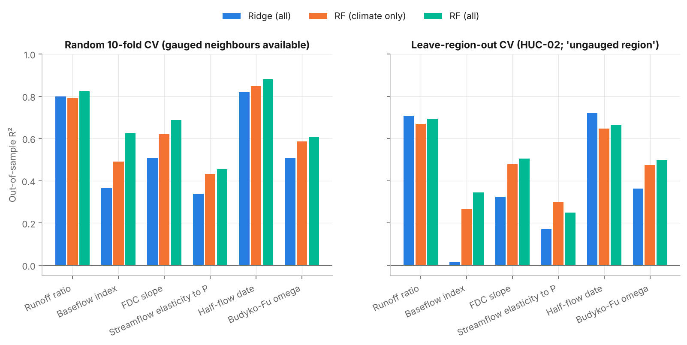
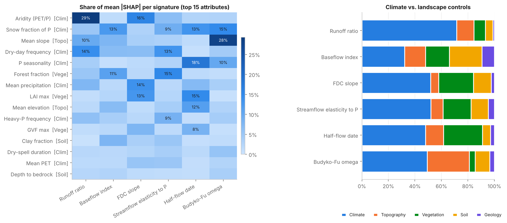
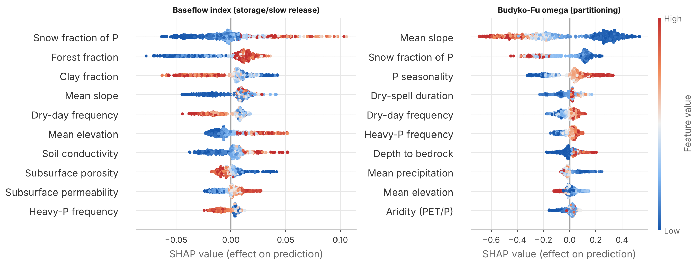
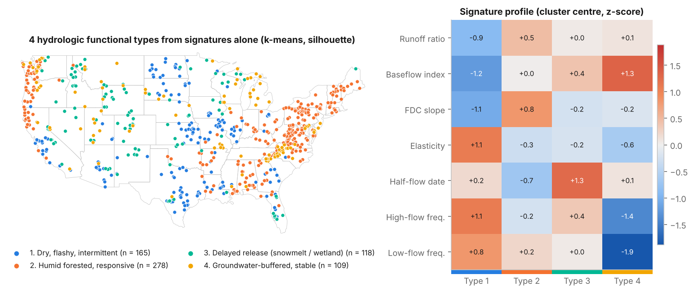
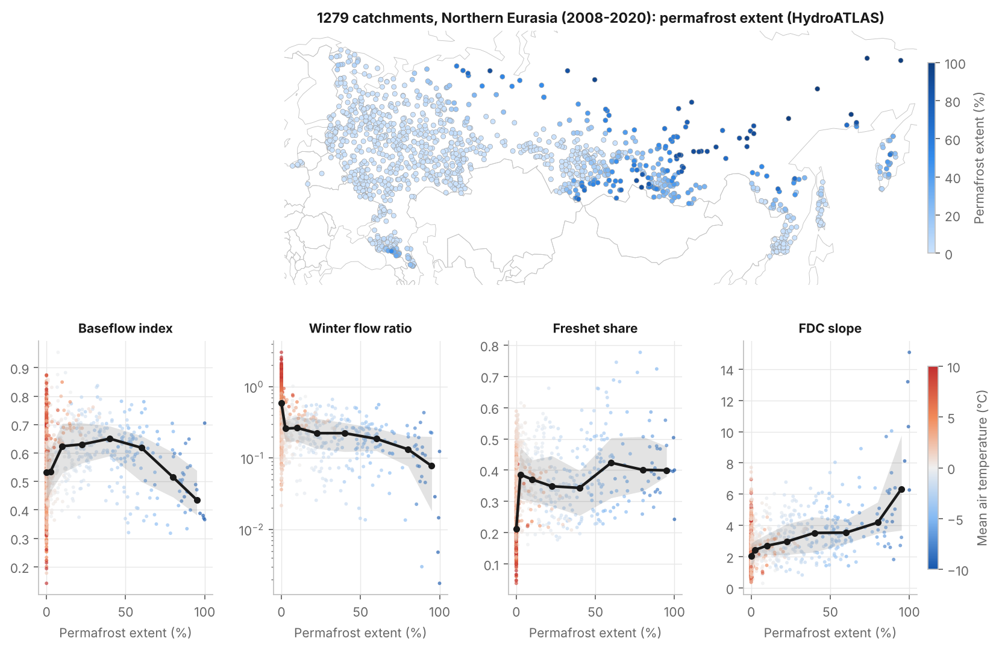
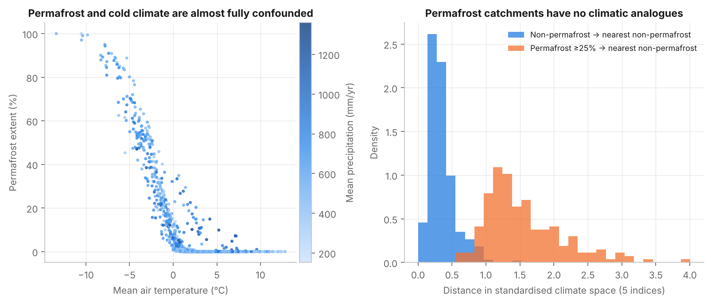
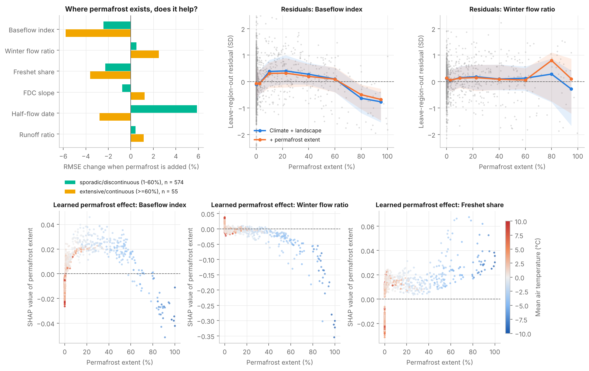

# What controls watershed hydrologic function? Explainable ML from CONUS to permafrost Eurasia

**Large-sample hydrology · hydrologic signatures · Budyko framework · random forests + SHAP · spatial cross-validation**

How a watershed *collects, stores and releases* water can be summarised by hydrologic
signatures (runoff ratio, baseflow index, flow-duration-curve slope, streamflow
elasticity, flow timing) and by its position in the Budyko space. The project has two parts:

- **Part 1:** 671 catchments of CAMELS-US, a well-studied benchmark.
- **Part 2:** 1,279 catchments of Northern Eurasia, from steppe to continuous permafrost. This region is
  missing from global large-sample datasets.

Part 1 asks:

1. **Which attributes control each aspect of hydrologic function?** Climate, topography, vegetation, soil or geology?
2. **How well can these functions be predicted in regions with no gauges at all?** (leave-region-out validation)
3. **Do catchments fall into a small number of functional types** that cut across geography?

Part 2 asks: **does permafrost control how watersheds store and release water, beyond what cold
climate explains?** ([jump to Part 2](#part-2--northern-eurasia-does-permafrost-control-hydrologic-function-beyond-climate))

Everything runs from this repository: Part 1 in about 6 minutes on a laptop, Part 2 in about 8 minutes from the
shipped catchment table. The signatures are computed from raw daily data by code in
`src/wfx/signatures.py`, checked against the published CAMELS values, and covered by unit tests.

---

## Key findings (Part 1, CAMELS-US)

| Signature | Main controls (share of mean \|SHAP\|) | R², random CV | R², leave-region-out |
|---|---|---|---|
| Runoff ratio | aridity 29%, dry-day frequency 14%, slope 10% | 0.82 | 0.69 (ridge 0.71) |
| Baseflow index | snow 13%, forest 11%, clay 8%, slope 8% | 0.63 | 0.35 |
| FDC slope (flashiness) | aridity 16%, mean P 14%, LAI 13% | 0.69 | 0.51 |
| Streamflow elasticity | forest 15%, dry-day frequency 13%, snow 9% | 0.45 | 0.25 |
| Half-flow date (timing) | P seasonality 18%, LAI 15%, snow 13% | 0.88 | 0.67 (ridge 0.72) |
| Budyko–Fu ω (partitioning) | slope 28%, snow 15%, P seasonality 10% | 0.61 | 0.50 |

*R² for the random forest on all attributes; ridge is shown where it beats it in the leave-region-out test.*

- **Climate dominates water *quantity*, landscape dominates water *storage*.** Climate attributes carry 71% of
  the explanatory weight for the runoff ratio but only 32% for the baseflow index, where soil (25%),
  vegetation (18%), topography (16%) and geology (9%) take over.
- **Landscape attributes matter most where storage matters.** Adding landscape attributes to a climate-only random forest
  raises R² for the baseflow index from 0.49 to 0.63 (random CV) and from 0.27 to 0.35 (leave-region-out).
  A linear model cannot do this out of region (ridge R² = 0.02): the storage controls are non-linear
  and interacting.
- **Steep and snowy catchments release more water than aridity predicts.** In the Budyko space, 655 of the 671 catchments lie
  within the physical limits; median Fu ω = 2.70 (IQR 2.01–3.35). Mean slope is the strongest single
  control on ω, followed by snow fraction. Both lower ω, meaning more runoff than aridity alone predicts.
- **Prediction in ungauged regions is the hard part.** Skill drops for every signature when whole regions
  (HUC-02) are withheld. For the climate-driven signatures (runoff ratio, timing), a simple ridge model
  transfers better than the random forest, because trees cannot extrapolate to unseen climates. This argues for
  hybrid models that combine data-driven learning with process constraints.
- **Four functional types emerge from behaviour alone:** dry, flashy and intermittent (n = 165);
  humid forested and responsive (n = 278); delayed release, through snowmelt or wetland storage (n = 118); and
  groundwater-buffered, stable (n = 109). The same type appears in distant regions, e.g. delayed-release
  catchments in both the Rockies and Florida.

---

## Results

### 1. Signatures from raw data


Lyne–Hollick baseflow separation (3 passes, α = 0.925) and the CAMELS signature set implemented from
scratch. The repository ships three years (2000–2002) of daily data for four catchments. The computed
values reproduce the **ranking** of the published 20-year CAMELS values. They are systematically
lower for runoff ratio and baseflow because 2001–2002 were drought years in the eastern US, which shows
why signature-based studies need long records.

### 2. Budyko space and Fu's ω


### 3. How predictable is each function, and where?


### 4. What controls each function?




**Baseflow index.** Higher with snow (slow melt recharge), forest cover, permeable and
conductive soils. Lower with clay and with frequent dry days.
**Fu ω.** Lower in steep, snowy catchments (less evaporation, more runoff). Higher with strongly
seasonal precipitation and deep soils, which give vegetation more water storage to draw on.

### 5. Hydrologic functional types


---

## Part 2 — Northern Eurasia: does permafrost control hydrologic function beyond climate?

Global large-sample datasets barely cover permafrost. The core Caravan dataset centres on the Americas,
Europe and Australia, and the GRDC-Caravan extension has no Asian stations. Part 2 applies the same
signature + XAI framework to **1,279 catchments across Russia and the CIS (2008–2020)**, built from the
open [hydro-meteorological database for watersheds across the CIS](https://doi.org/10.5281/zenodo.8432070)
(Abramov & Kurochkina, 2023). The sample spans a full permafrost gradient: 650 catchments without permafrost,
574 with sporadic or discontinuous permafrost (1–60%), and 55 with extensive or continuous permafrost
(≥60%), mostly in the Aldan, Olyokma, Vitim and upper Lena basins of southern Yakutia and Transbaikalia.



| Permafrost extent | n | Baseflow index | Winter flow ratio (Q<sub>JFM</sub>/Q̄) | Freshet share (May–June) | FDC slope | Mean T (°C) |
|---|---|---|---|---|---|---|
| 0% | 650 | 0.53 | 0.61 | 0.20 | 1.97 | 4.4 |
| 1–60% | 574 | 0.59 | 0.25 | 0.36 | 2.73 | 0.3 |
| 60–90% | 45 | 0.52 | 0.15 | 0.40 | 4.11 | −5.6 |
| ≥90% | 10 | 0.43 | 0.08 | 0.40 | 6.33 | −9.1 |

*Medians per class.*

**Findings**

- **Baseflow peaks in discontinuous permafrost and collapses in continuous permafrost.** Along the
  gradient, winter flow drops by almost an order of magnitude and the flow regime becomes flashier and more
  freshet-dominated. The baseflow index behaves differently: it *rises* in sporadic and discontinuous permafrost
  and only falls once permafrost becomes extensive or continuous. This is consistent with a frozen layer
  that confines subsurface storage only once it becomes laterally continuous.
- **Permafrost and climate are almost fully confounded.** Every catchment with ≥25% permafrost is far from
  its nearest climatic analogue without permafrost: the median distance in standardised climate space is 1.43,
  against 0.30 between non-permafrost neighbours. Climate-matched comparison is not possible
  with this sample.



- **The models miss something systematic.** A random forest with climate and landscape attributes, tested
  leave-region-out on 12 spatial blocks, overpredicts the baseflow index of extensive/continuous-permafrost
  catchments by 0.56 SD and underpredicts their freshet share by 0.39 SD. Adding HydroATLAS permafrost
  extent lowers the RMSE there (−5.8% for the baseflow index, −3.6% for the freshet share) but leaves most of the
  bias (−0.49 SD, +0.35 SD). For the other signatures it adds nothing.
- **Interpretation.** A static, lumped "percent permafrost" attribute is not enough to represent how
  permafrost controls storage and release, and with observational data alone its effect cannot be
  separated from cold climate. Testing this needs process-based constraints (active-layer
  thickness, ground ice, talik connectivity) and time-varying analyses as permafrost thaws. This is the
  question I would like to pursue in a PhD.



**Caveats.** Precipitation comes from ERA5-Land, which closes the water balance better than the other products in
the database (median Q/P = 0.44, against 0.65 for MSWEP). Still, 134 catchments, mainly in the Sayan and Altai
mountains, have Q > P; they are excluded from the runoff-ratio model. HydroATLAS quality is lower north of
60°N, and the continuous-permafrost north of Yakutia (Yana, Indigirka, Anabar) has no discharge records
for 2008–2020 in this database. Its tributaries are the obvious next addition, from Roshydromet / AIS GMVO
records. The 13-year record is short for elasticity and timing signatures.

---

## Methods

| Step | What | Where |
|---|---|---|
| Data | CAMELS-US attributes for 671 catchments (climate, topography, vegetation, soil, geology, signatures, WY 1990–2009); daily USGS streamflow and Daymet forcing for 4 sample catchments | `data/` |
| Signatures | runoff ratio, BFI (Lyne–Hollick), FDC slope, streamflow elasticity (Sankarasubramanian), Q5/Q95, high/low-flow frequency and duration, half-flow date | `src/wfx/signatures.py` |
| Budyko | evaporative index E/P = 1 − Q/P; Fu's equation solved for ω per catchment (Brent's method); points outside the limits flagged | `src/wfx/budyko.py` |
| Models | ridge regression vs. random forest (500 trees), climate-only vs. all 28 attributes. Latitude and longitude are excluded on purpose, so the models must learn from physical attributes | `src/wfx/modeling.py` |
| Validation | 10-fold random CV vs. leave-one-region-out CV (18 HUC-02 regions) | `src/wfx/modeling.py` |
| Explanation | SHAP TreeExplainer; mean \|SHAP\| aggregated by attribute group | `scripts/03_explainable_ml.py` |
| Clustering | k-means on 7 standardised signatures, k chosen by silhouette score (k = 4) | `scripts/04_functional_types.py` |

## Reproduce

```bash
git clone https://github.com/<your-username>/watershed-function-xai.git
cd watershed-function-xai
python -m venv .venv && source .venv/bin/activate   # Windows: .venv\Scripts\activate
pip install -e ".[dev]"

python scripts/01_signature_check.py      # signatures from raw data   (~5 s)
python scripts/02_budyko.py               # Budyko + Fu omega          (~2 s)
python scripts/03_explainable_ml.py       # models, CV, SHAP           (~5 min)
python scripts/04_functional_types.py     # functional types           (~10 s)

# Part 2 - uses the shipped table data/northern_eurasia/catchment_table.csv
python scripts/06_permafrost.py           # permafrost analyses        (~8 min)
# optional: rebuild that table from the raw database (3.5 GB, https://doi.org/10.5281/zenodo.8432070)
pip install -e ".[raw]"
python scripts/05_build_northern_eurasia_table.py /path/to/Russia_HydroMeteo_Database_v04
pytest                                    # unit tests
```

Outputs are written to `figures/` and `results/` (CSV tables of model skill, SHAP importances,
ω per catchment and the functional type of each catchment).

```
├── data/camels_us/           CAMELS attributes + 4-catchment daily sample
├── data/northern_eurasia/    per-catchment table (2,164 catchments): signatures, climate, HydroATLAS
├── src/wfx/                  io, signatures, climate, budyko, features, modeling, northern_eurasia, plotting
├── scripts/                  01-04 Part 1, 05-06 Part 2
├── tests/                    unit tests (baseflow filter incl. gaps, elasticity, Fu round-trip, climate indices, data)
├── figures/  results/        generated outputs
```

## Limitations and next steps

- **Global scale.** Part 2 uses the same HydroATLAS attributes as
  [Caravan](https://doi.org/10.1038/s41597-023-01975-w), so both parts can be merged with Caravan into one global
  sample covering forested, mountainous, wetland, agricultural, urban *and* permafrost watersheds. The
  Northern Eurasian catchments could also be contributed to Caravan as an extension.
- **Process links.** Relate the data-driven controls to conceptual-model parameters (e.g. GR4J, HBV
  storage and recession parameters) to see whether ML-identified controls match process understanding.
- **Non-stationarity.** Compute signatures in moving windows to track how hydrologic function shifts
  with climate and land-use change.
- **Data-scarce regions.** Transfer the trained relationships to poorly gauged basins, such as reservoir
  inflow stations in Türkiye (the topic of my MSc thesis), and quantify the loss of skill.
- SHAP shows associations learned by the model, not causal effects. Correlated attributes (e.g. slope,
  elevation and snow) share credit.

## Data and references

- Addor, N., Newman, A. J., Mizukami, N., Clark, M. P. (2017). The CAMELS data set: catchment attributes and meteorology for large-sample studies. *HESS*, 21, 5293–5313. https://doi.org/10.5194/hess-21-5293-2017
- Newman, A. J. et al. (2015). Development of a large-sample watershed-scale hydrometeorological data set for the contiguous USA. *HESS*, 19, 209–223. https://doi.org/10.5194/hess-19-209-2015
- Addor, N. et al. (2018). A ranking of hydrological signatures based on their predictability in space. *WRR*, 54, 8792–8812. https://doi.org/10.1029/2018WR022606
- Fu, B. (1981). On the calculation of the evaporation from land surface. *Scientia Atmospherica Sinica*, 5, 23–31.
- Ladson, A. et al. (2013). A standard approach to baseflow separation using the Lyne and Hollick filter. *Australasian J. Water Resources*, 17(1), 25–34.
- Sankarasubramanian, A., Vogel, R. M., Limbrunner, J. F. (2001). Climate elasticity of streamflow in the United States. *WRR*, 37(6), 1771–1781.
- Janssen, J., Ameli, A. A. (2021). A hydrologic functional approach for improving large-sample hydrology performance in poorly gauged regions. *WRR*, 57(9).
- Lundberg, S. M., Lee, S.-I. (2017). A unified approach to interpreting model predictions. *NeurIPS*.
- Abramov, D., Kurochkina, L. (2023). Hydro-meteorological database for watersheds across the CIS (v1.3). Zenodo. https://doi.org/10.5281/zenodo.8432070 (CC BY 4.0). Published in *Russian Meteorology and Hydrology*.
- Linke, S. et al. (2019). Global hydro-environmental sub-basin and river reach characteristics at high spatial resolution (HydroATLAS). *Scientific Data*, 6, 283. https://doi.org/10.1038/s41597-019-0300-6
- Muñoz-Sabater, J. et al. (2021). ERA5-Land. *ESSD*, 13, 4349–4383. https://doi.org/10.5194/essd-13-4349-2021 · Martens, B. et al. (2017). GLEAM v3. *GMD*, 10, 1903–1925.
- Färber, C. et al. (2025). GRDC-Caravan: extending Caravan with data from the Global Runoff Data Centre. *ESSD*, 17, 4613–4625. https://doi.org/10.5194/essd-17-4613-2025
- Sample data files (CAMELS attributes and 4-basin time series) are redistributed from the test data of [NeuralHydrology](https://github.com/neuralhydrology/neuralhydrology). US state outlines: PublicaMundi `us-states.json`; country outlines: `johan/world.geo.json`.

## Author

**Kristina Grigoreva**, MSc student in Integrated Water Systems Management, Ankara University ·
ORCID [0009-0001-0011-4580](https://orcid.org/0009-0001-0011-4580) ·
[LinkedIn](https://www.linkedin.com/in/kristina-grigoreva-869ba5354)

Code: MIT licence. Data: see the citations above.
